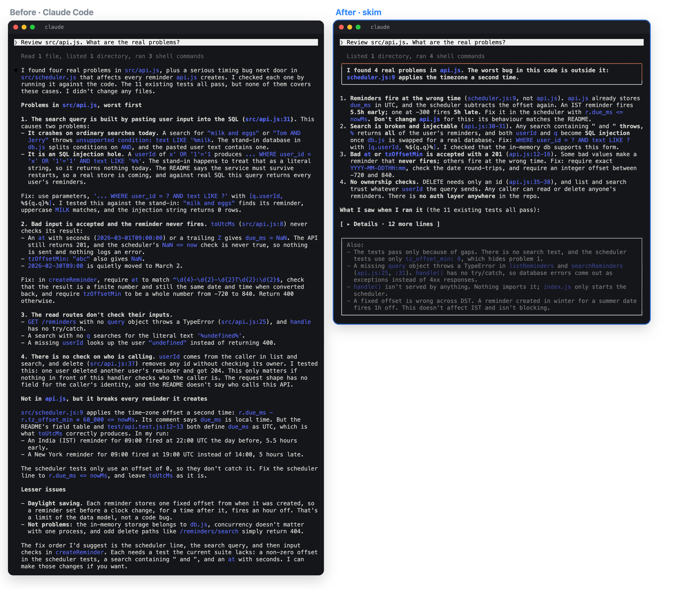
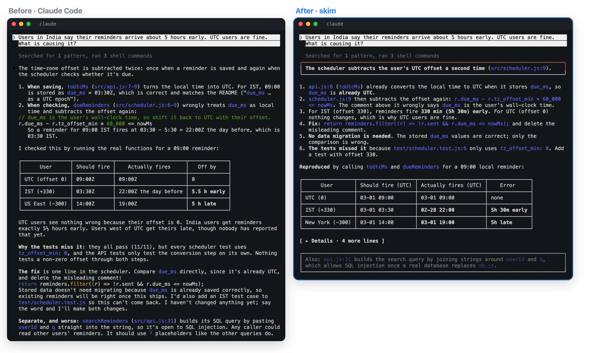
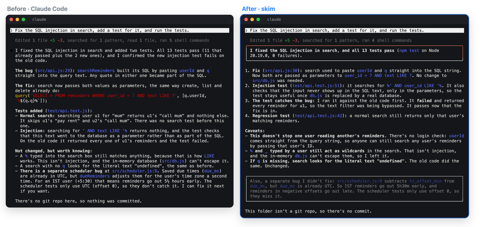
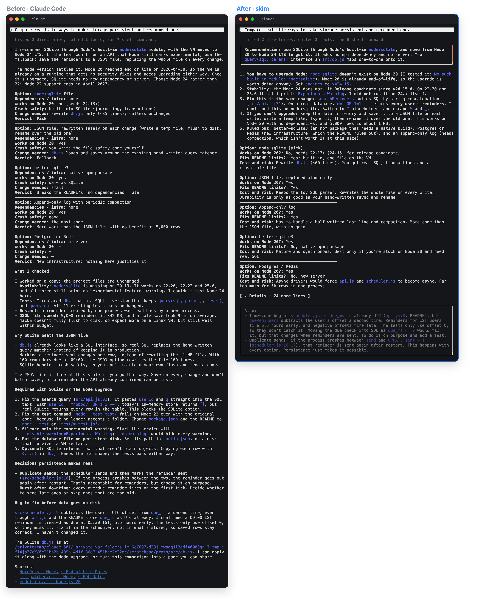
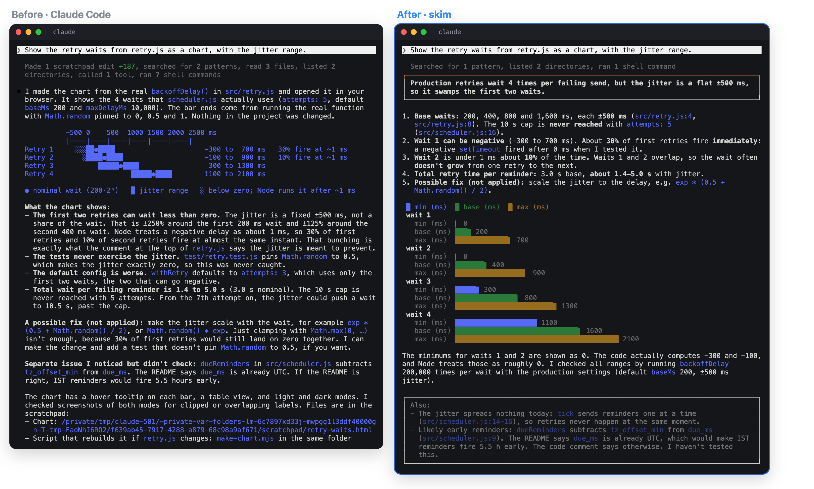
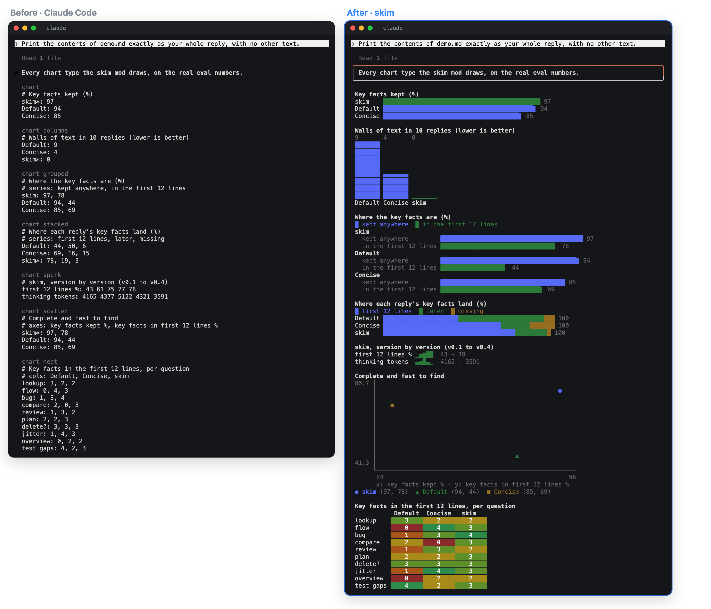

<div align="center">

# skim

### Claude writes. You skim.

**You spend your day reading Claude's replies, and the answer is buried in them.**<br>
In our tests, plain Claude Code put only 44% of the key facts in the first 12 lines,<br>
and 6 of 10 replies had a wall of text.

**skim makes Claude put the answer first, then draws it for your terminal:**<br>
framed answers, numbered findings, folded details, real charts.

[](CHANGELOG.md)
[](#install)
[](LICENSE)



<sub>Real sessions, same prompt, same model (Claude Opus), same code. Whole replies, recorded in an 88-column terminal.</sub>

</div>

<div align="center">
<table>
<tr>
<td align="center" width="20%"><h2>78%</h2>of key facts in<br>the first 12 lines<br><sub>default 44%</sub></td>
<td align="center" width="20%"><h2>97%</h2>of key facts<br>kept in the reply<br><sub>default 94%</sub></td>
<td align="center" width="20%"><h2>15%</h2>shorter replies<br>to read<br><sub>894 vs 1,047 tokens</sub></td>
<td align="center" width="20%"><h2>0</h2>walls of text<br>in 10 replies<br><sub>default 9</sub></td>
<td align="center" width="20%"><h2>3 / 3</h2>coding tasks<br>still pass<br><sub>default 3/3</sub></td>
</tr>
</table>
<sub>10 questions + 3 coding tasks, blind judge · <a href="#the-numbers">method and limits ↓</a></sub>
</div>

## Install

```
/plugin marketplace add PranavMeht4/skim
/plugin install skim@skim
```

Restart Claude Code, then:

```
/output-style skim:skim
```

<sub>For every project: add `"outputStyle": "skim:skim"` to `~/.claude/settings.json`. Needs Claude Code 2.1.287 or newer.</sub>

## Before / after

Every pair below is two real sessions with the same prompt: plain Claude Code on the left, skim on the right.

### A bug



Both find the cause. skim states it on line 1, numbers the facts and folds the rest.

### A finished task



Same fix, 13/13 tests on both sides. skim frames the result and moves the bug it wasn't asked about into **Also**.

### A comparison



Both pick SQLite. skim frames the pick and puts the five facts that decide it first.

### A chart



Ask for a chart and skim draws it with real bars, in the terminal.

### Every chart it draws



Left: what a `chart` block looks like without skim. Right: bars, columns, grouped, stacked, sparklines, scatter and a heat map, all drawn from the real eval numbers.

## What you get

| In every reply | How it looks |
|---|---|
| **the answer** | line 1, framed: green ✓, red ✗, yellow ⚠ |
| **every key fact** | in the first lines, one per line, with `file:line` |
| **anything you didn't ask about** | one dimmed **Also** box |
| **`❓ Needs you` · `⚠ Risk`** | colored callouts; Needs-you stays pinned above your prompt |
| **long detail** | folded behind **▸ Details** |
| **"13/13 tests pass"** | a green and red test bar |
| **a diagram or chart you ask for** | boxes, arrows and 7 chart types, drawn |

skim tells Claude what to put first, then draws it. Same model, same tools, same work.

**It leaves alone:** your code, comments, commits, PRs and docs (normal conventions); how Claude investigates and tests; your choice of style (`/output-style` switches back any time).

## The numbers

10 read-only questions and 3 coding fixes on a small Node service with planted bugs. Each answer's key facts were checked by a blind Sonnet judge (3 passes) against ground truth written **before** any run; fixes were checked by hidden tests.

| | Default | Concise | **skim** |
|---|:-:|:-:|:-:|
| key facts kept | 94% | 85% | **97%** |
| key facts in the first 12 lines | 44% | 69% | **78%** |
| line 1 is the answer | 70% | **100%** | **100%** |
| walls of text (10 replies) | 9 | 4 | **0** |
| coding fixes passed | 3/3 | – | 3/3 |

<details>
<summary><b>Cost and speed</b></summary>

| | Default | Concise | skim |
|---|:-:|:-:|:-:|
| the reply you read (tokens) | 1,047 | **679** | 894 |
| Claude's thinking (tokens) | 3,484 | **2,191** | 3,591 |
| steps per question | 14.7 | 11.2 | 15.5 |
| time per question | 111 s | **88 s** | 132 s |

- **Thinking and steps match default.** skim doesn't cut the investigation; Concise does (11 steps vs 15) and keeps fewer facts.
- **Answers take ~20 s longer.**
- **The rules add ~600 cached input tokens.** The display costs nothing: it redraws on your screen, and Claude and the transcript keep the text.

</details>

<details>
<summary><b>What these numbers don't show</b></summary>

- **One run per question.** One fact is ~2.8 points, so 97% vs 94% is a tie.
- **The coding fixes are easy.** 3/3 shows the work isn't broken, not that it's proven on hard tasks.
- **Measured on Opus only.** A Sonnet spot check once broke the line-1 rule.
- **No reading-speed test with people yet.** The numbers measure where facts appear.
- Every answer, verdict and script: [`evals/`](evals). Run it yourself with `node evals/run.mjs --date mine` (≈ $20 of Opus usage).

</details>

## FAQ

<details><summary><b>Why not the built-in Concise style?</b></summary>

Concise is short and free, but in our tests it also investigated less (11 steps vs 15) and kept fewer key facts (85%). skim puts more on the first screen (78% vs 69%), keeps 97%, and draws the structure.
</details>

<details><summary><b>Does it change what Claude sees?</b></summary>

No. The drawing happens on your screen only. Claude, the transcript and anything you copy keep the plain Markdown, which also reads fine without skim.
</details>

<details><summary><b>Codex or other agents?</b></summary>

The rules work anywhere that reads `AGENTS.md`: append [`AGENTS.md`](AGENTS.md) to `~/.codex/AGENTS.md`. The drawing is Claude Code only.
</details>

<details><summary><b>How do I see my own numbers, or turn it off?</b></summary>

```
/skim:stats                         how your replies score (counts only, stored locally)
/output-style default               switch styles
claude plugin uninstall skim@skim   remove it and its stats log
```
</details>

## How it's built

```
output-styles/skim.md   what Claude writes first (≈600 tokens)
hooks/register.tsx      draws each reply: cards, Also box, callouts, fold, test bars
hooks/charts.tsx        7 chart types       hooks/flow.tsx   diagrams
hooks/hooks.json        + a Stop hook that scores replies for /skim:stats
evals/                  the test project, runner, blind judge and every raw answer
docs/shots/             how the screenshots above were recorded
```

## License

[MIT](LICENSE)
